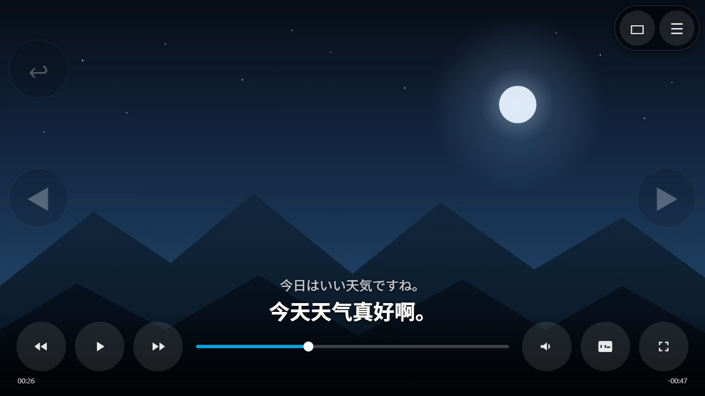

# remote-jellyfin-player

> 远程串流场景下的 Jellyfin 播放器。
>
> A Jellyfin player for remote streaming scenarios.

- **解决 Jellyfin 远程转码播放时上传流量过高的问题 |
  Solves excessive upload traffic when Jellyfin plays back transcoded content remotely**
- **在 Moonlight 或类似串流方案的基础上,提供 Jellyfin 原生播放器的基础手势操作 |
  On top of Moonlight or similar streaming, provides the basic gestures the native player lacks**
- **为视频提供实时字幕功能 |
  Provides live subtitles for the video**

## 三个特性 / Three features

### 1. 远程转码播放上传流量过大 → 压到可计算的固定值

**Excessive upload volume when playing transcoded content remotely — we bring it down to a
calculable fixed value.**

远程播放时,Jellyfin 常常需要**转码**:服务端把片源实时转成客户端能播的格式,再推给对端。
这条链路产生的上传流量有两块,加起来就是总量:

- **转码输出的码率** —— 由服务端和客户端协商决定,随片源、随设置变化
- **每次起播的重建开销** —— 重新协商、探测、起缓冲,并**激进预缓冲**
  (一次拉取远超实际播放需要的量,边播边继续预取)

第二块是总量被推高的主因,尤其在**多部剧集反复切换**时:切一次就要重建一遍流,
而绝大多数内容只看十几秒 —— **看了十几秒,却付了一整段缓冲的流量**。

这一点在国内还有额外影响:**上传流量长期过大,容易被运营商判定为 PCDN 而限速或断网**。

**本项目的思路**:让上传流量从"每次起播都重新拉一遍"变成**一次恒定码率的持续输出**,
把总量压下来并可提前算清。

用 Electron 套壳承载 Jellyfin Web,再通过 Moonlight 或类似串流方案输出成**单一视频通道**:

- 码率**恒定**,只取决于你设的值(建议 4–8 Mbps),与片源、与内容无关
- 切剧只是换内容,**不重建通道**,没有重复协商与预缓冲的开销
- 于是总上传量 = 码率 × 实际观看时长,**看多久就花多少**

> When playing remotely, Jellyfin often has to **transcode**: the server converts the source in
> real time into something the client can play, then pushes it out. The upload volume on this path
> is the sum of two parts:
>
> - **the transcoded output bitrate** — negotiated between server and client, varying with source
>   and settings
> - **the per-playback setup cost** — renegotiate, probe, buffer up, and **aggressively
>   prefetch** (pull far more than playback needs, keep prefetching while playing)
>
> The second part is the main reason the total is so high, especially when **switching among many
> titles**: every switch rebuilds the stream, yet most of them you watch for only a few seconds —
> **you watch fifteen seconds but pay for a full buffer**.
>
> In China this has an extra consequence: **sustained heavy upload tends to get flagged as PCDN by
> the ISP, leading to throttling or disconnection**.
>
> **This project's approach** turns upload from "re-pull everything on every playback start" into
> **one continuous output at a constant bitrate**, bringing the total down and making it
> predictable. Jellyfin Web runs inside Electron and is emitted over **a single video channel** via
> Moonlight or similar streaming: the bitrate is **constant** (whatever you set, 4–8 Mbps
> recommended), independent of source and content; switching episodes only swaps content
> **without rebuilding the channel**, so there is no repeated negotiation or prefetch. The total
> upload is then **bitrate × actual watch time** — you pay for what you watch.

#### 真实场景:想看的时候,在多部剧集之间来回切换

这个项目针对的场景很具体 —— **不是坐下来看完整一部,而是"想看点什么"的时候,
在多部剧集之间反复切换挑选**:

打开一部,看十几秒,不太对味,换下一部;再看十几秒,再换。
可能连着切十几部、二十几部,来回比较,直到找到想看的才停下来。

这个过程中,**每一次起播都是一次完整的流量开销** —— 而绝大多数内容你只看了十几秒。

两种方案在这个场景下的流量差距是 **20~40 倍**(实测数据):

| 方案 | 预览 10 秒 | 来回切 10 次 | 完整看 2 小时 |
|---|---|---|---|
| **Jellyfin 直连/转码播放** | ~81 MB | ~800 MB | 1.2 GB |
| **Moonlight 串流 @4 Mbps** | **5 MB** | **50 MB** | 3.5 GB |

**为什么差这么多**:Jellyfin 每次开始播放都要**重新建立流**——协商、探测、起缓冲、
预取远超需要的量(即使你只看十几秒)。切一次就重来一遍,切十次就是十遍。
而 Moonlight 是**一条持续存在的通道**:切剧只是换画面内容,通道不动,
流量跟着播放时间线性增长,**看十几秒就只花十几秒的钱**。

> The scenario is specific — **not sitting through a whole title, but picking one by
> switching back and forth among many**:
>
> Open one, watch fifteen seconds, not quite right, switch to the next; another fifteen
> seconds, switch again. You might cycle through a dozen or two dozen titles, comparing,
> until something clicks.
>
> Along the way **every playback start costs a full stream setup** — yet you watched most
> of them for only a few seconds.
>
> In this pattern the two approaches differ by **20–40×** (measured):
>
> | Approach | 10-second preview | Switching 10 times | Watching 2 hours |
> |---|---|---|---|
> | **Jellyfin direct / transcoded** | ~81 MB | ~800 MB | 1.2 GB |
> | **Moonlight stream @4 Mbps** | **5 MB** | **50 MB** | 3.5 GB |
>
> **Why such a gap:** every Jellyfin playback start **rebuilds the stream** — negotiate, probe,
> buffer up, and prefetch far more than needed, even if you only watch fifteen seconds. Switch
> ten times and you pay that ten times. Moonlight is **one persistent channel**: switching
> episodes only changes the picture, the channel stays up, and traffic grows linearly with
> playback time — **fifteen seconds of watching costs fifteen seconds of traffic.**

### 2. Moonlight 远程播放时 Jellyfin 官方播放器手势不可用

**Jellyfin's official player has no usable touch gestures under Moonlight remote play.**

Moonlight 的 Direct Touch 模式把触摸转换成鼠标事件转发给主机。
Jellyfin 官方播放器是为真实触摸屏设计的,拿到这类转发的鼠标事件后:

- 左右滑动**不能**快进快退
- 上下滑动**不能**调音量
- 每次滑动还会撞上它自己的单击暂停逻辑(实测:滑完就暂停)

**本项目的做法**:在 preload 层识别手势,不依赖页面原本的行为。

- 横滑快进/快退,秒数**随滑动距离折算**(5~60 秒,不会一滑跳太远)
- 竖滑调音量
- 左边缘右滑 = 返回上一层
- 单击保留 Jellyfin 原生行为,双击播放/暂停
- 连续滑动**去抖合并**,避免触发多次重缓冲造成卡顿
- 播放页提供 `◀ ▶ ↩` 虚拟按键,浏览页提供 `▲ ▼ ↩` 滚动与返回键

> Moonlight's Direct Touch mode converts touch into mouse events forwarded to the host.
> Jellyfin's official player targets real touchscreens, so under forwarded mouse events:
> horizontal swipes do **not** seek, vertical swipes do **not** change volume, and every swipe
> collides with its own click-to-pause logic (it pauses right after a swipe in our tests).
>
> **This project** recognizes gestures in the preload layer instead of relying on the page.
> Swipe distance maps to seek seconds (clamped to 5–60s), vertical swipe adjusts volume,
> left-edge swipe goes back, single click keeps Jellyfin's native behavior, double click toggles
> play/pause. Consecutive swipes are debounced into one seek to avoid repeated buffering, and
> on-screen buttons (`◀ ▶ ↩` while playing, `▲ ▼ ↩` while browsing) cover everything else.

### 3. 视频里的语音没有翻译

**Spoken audio in the video has no translation.**

字幕文件可以翻译,但**没有字幕的片子**就没办法。想对着画面听外语看懂,只能靠人。

**本项目的做法**:提供**可插拔的实时语音翻译接口** ——
对视频里的音频流做实时识别 + 翻译,不依赖任何字幕文件,也不要求片子自带字幕。

工作方式(预取窗口):

```
Jellyfin 音频流(可寻址,任意时间点都能立刻切出)
   │  ffmpeg 切 10 秒窗口
   ▼
faster-whisper large-v2 识别
   │  ~1.5 秒
   ▼
翻译后端(可插拔)
   │  ~1.6 秒
   ▼
双语字幕叠加到画面上
```

因为预取的是**未来**的音频,字幕能比画面**提前 6 秒以上**就绪,播放时零等待。

翻译后端可切换,改 `config.json` 即可、不用改代码:

| 后端 / Backend | 说明 / Notes |
|---|---|
| `ollama`(默认) | 本地模型,免费、离线、无限速 / local, free, offline |
| `openai` | 任何 OpenAI 兼容接口(通义、智谱、vLLM、LM Studio 等) |
| `deepl` | DeepL API |
| `none` | 只显示原文,不翻译 |

> Subtitle files can be translated, but **videos without subtitles** cannot — there is no way to
> follow foreign speech except by ear.
>
> **This project** provides a **pluggable real-time speech translation interface**: it recognizes
> and translates the video's audio stream directly, with no dependency on subtitle files.
> It prefetches a 10-second window of audio via ffmpeg, runs faster-whisper large-v2, then
> translates through a pluggable backend, and overlays bilingual subtitles. Because it prefetches
> *future* audio, subtitles are ready **6+ seconds ahead** of the picture — no waiting during
> playback. Backends: `ollama` (default, local/free/offline), `openai`-compatible (any vendor),
> `deepl`, or `none`.

---




> 上图由**真实程序渲染**后截图,视频画面使用模拟素材(夜景),不是真实影片。
> The screenshot above is **rendered by the real application**; the video frame uses mock footage
> (a night landscape), not a real movie.

---


## 快速上手 / Quick Start

### 界面元素对应关系

对照上图,界面上的元素分别是:

| 位置 | 元素 | 作用 |
|---|---|---|
| 左上 | `↩` 返回 | 返回上一层。与「左边缘右滑」等效 |
| 左中 | `◀` 快退 | 按滑动距离折算,一次 5–60 秒 |
| 右中 | `▶` 快进 | 同上;连续点会合并成一次跳转 |
| 右上 | 长条工具栏 | `▭` 开关 Jellyfin 控制栏 · `☰` 打开选项菜单 |
| 画面下方 | 双语字幕 | 上行为识别原文,下行为翻译结果 |
| 左下 | 操作提示 | 动作反馈,15px 小字,不挡画面 |
| 底部 | Jellyfin 控制栏 | 原生控件,可用右上工具栏的 `▭` 手动开关 |

### 手势一览

| 手势 | 效果 |
|---|---|
| 横向右滑 | 快进(按距离 5–60 秒) |
| 横向左滑 | 快退(按距离 5–60 秒) |
| 向上滑 | 音量 + |
| 向下滑 | 音量 − |
| **左边缘**向右滑 | 返回上一层 |
| 单击画面 | Jellyfin 原生行为(默认是暂停/弹控制栏) |
| 双击画面 | 播放 / 暂停 |

### 虚拟按键

播放页与浏览页的按键不同,自动切换:

- **播放页**:`↩` 返回 · `◀` 快退 · `▶` 快进
- **浏览页**:`↩` 返回 · `▲` 上滚 · `▼` 下滚

按键特性:

- 半透明,不挡画面;鼠标悬停会变亮
- 可拖动调整位置,**不记忆**(每次进入回到默认位置)
- 右上角工具栏整体可拖动,**会记忆**位置

### 选项菜单(`☰`)

| 菜单项 | 说明 |
|---|---|
| `⚙ 设置` | 打开设置面板,6 组参数可视化调节 |
| `↺ 按键位置复位` | 按钮被拖乱后一键回默认位置 |
| `🌐 实时字幕` | 开 / 关实时语音翻译 |
| `⏻ 退出` | 退出播放器 |

### 设置面板

点 `⚙ 设置` 打开,改完点「保存」写回 `config.json`,能热生效的项立即生效。

| 分组 | 可调内容 |
|---|---|
| 实时字幕 | 识别语言、翻译模型、翻译后端、接口地址与 Key |
| 字幕过滤(消除幻觉) | 开关、4 个置信度阈值、同句重复上限 |
| 字幕样式 | 双语开关、译文字号、距底部高度 |
| 手势 | 快进方式、上限、最小距离、返回热区宽度 |
| 界面 | 控件放大、OSD 按钮尺寸、进度条厚度 |
| 调试 | 手势判定日志开关 |

### 实时字幕怎么用

1. 在播放页点右上角 `☰` → `🌐 实时字幕:关` 让它变成「开」
2. 首次开启需等模型加载(约 5–10 秒),之后每次开启都很快
3. 字幕会以双语形式显示在画面下方

字幕状态是**保持**的:换片、切页面都不会丢,离开播放页超过 45 秒才自动停。

---


## 安装与运行 / Installation

### 环境要求

| 依赖 | 版本 | 用途 |
|---|---|---|
| Node.js | ≥ 18 | 运行 Electron |
| Jellyfin Server | 12.x | 片源服务端 |
| Python | 3.10 | **仅实时字幕需要** |
| NVIDIA GPU | 显存 ≥ 4GB | **仅实时字幕需要**(可用 CPU 但很慢) |
| Ollama | 任意 | **仅实时字幕需要**(默认翻译后端) |

### 1. 只用手势功能(不需要 Python / GPU)

```powershell
git clone https://github.com/markgoo/remote-jellyfin-player.git
cd remote-jellyfin-player
npm install
npx electron .
```

默认连接 `http://127.0.0.1:8096`。Jellyfin 在别的机器上时:

```powershell
npx electron . --server http://<你的jellyfin地址>:8096
```

不装 Jellyfin 也能试手势:

```powershell
npx electron . --local-test
# 打开后把本地视频文件拖进窗口即可
```

### 2. 启用实时字幕

需要额外三步。

**第一步:创建 Python 环境**

```powershell
python -m venv .stt\venv
.\.stt\venv\Scripts\python.exe -m pip install faster-whisper
```

> **注意**:`pip install faster-whisper` 在部分环境会误装 torch(4GB+)。
> faster-whisper 其实只需要 `ctranslate2`。若遇到超时,可先装
> `ctranslate2 numpy pyyaml av tokenizers onnxruntime huggingface_hub`,
> 再把 faster-whisper 的 wheel 单独装上。

**第二步:准备 Whisper 模型**

任选其一:

```powershell
# 方式 A:用 Hugging Face 上的 faster-whisper 模型(推荐 large-v2,约 2.9GB)
#   下载后放到任意目录,然后在 config.json 里指向它:
#   "sttModelPath": "D:\\models\\faster-whisper-large-v2"

# 方式 B:不填 sttModelPath,程序会用内置默认路径
```

**第三步:准备翻译后端**

默认用 Ollama(本地、免费、不需要联网):

```powershell
ollama pull qwen3.5:9b
```

不想用 Ollama 就改 `config.json` 的 `sttTranslator`,可选
`openai`(任何兼容接口)、`deepl`、`none`(只显示原文)。

### 3. GPU 支持(可选但强烈建议)

不装 CUDA 库会报 `Library cublas64_12.dll is not found`:

```powershell
.\.stt\venv\Scripts\python.exe -m pip install nvidia-cublas-cu12 nvidia-cudnn-cu12
```

装完**必须**把这两个目录加进 `PATH`:

```
.stt\venv\Lib\site-packages\nvidia\cublas\bin
.stt\venv\Lib\site-packages\nvidia\cudnn\bin
```

> 程序启动字幕服务时会自动把这两个目录加进子进程的 PATH,通常不用手动设置。

想用 CPU 跑(慢很多),改 `config.json`:

```json
"sttDevice": "cpu",
"sttComputeType": "int8"
```

### 4. 打包成 exe

```powershell
npm run dist
# 产物在 dist\win-unpacked\
```

打包后 `tools/` 和 `.stt/venv/` **需要和 exe 放在一起**,否则字幕功能不可用。

### 配置说明

所有参数在 `config.json`(与 exe 同目录),常用几项:

| 参数 | 默认 | 说明 |
|---|---|---|
| `serverUrl` | `http://127.0.0.1:8096` | Jellyfin 地址 |
| `seekMode` | `scaled` | `scaled` 按距离 / `fixed` 固定秒数 |
| `seekStepSeconds` | `10` | 快进基准秒数 |
| `seekMaxSeconds` | `60` | 单次快进上限 |
| `uiScale` | `1.25` | 界面整体放大倍数 |
| `enableLiveSubtitle` | `true` | 实时字幕总开关 |
| `sttTranslator` | `ollama` | 翻译后端 |
| `sttLlm` | `qwen3.5:9b` | 翻译模型 |
| `sttCacheEnabled` | `true` | 字幕磁盘缓存 |
| `debug` | `false` | 详细日志(排查时开,见下节) |

改完重启应用生效;部分项可在设置面板里改并热生效。

### 排查问题:日志

**这个项目的日志是给 AI 看的,不是给人肉读的。** 遇到问题不需要自己分析,
把日志交给 AI 就能定位 —— 日志里有意保留了足够的上下文(手势判定、字幕会话、
预取窗口、跳转对齐、过滤原因等)。

**日志位置**:优先写在 exe 旁边,那里不可写时退回用户数据目录:

```
1) <exe 所在目录>\jellyfin-player.log          ← 通常就是这里
2) %APPDATA%\jellyfin-player\jellyfin-player.log  ← 上面写不了时
```

日志超过 512 KB 会自动轮转为 `jellyfin-player.log.old`,不会无限增长。

**要开 `debug` 才有完整内容**:

```json
"debug": true
```

开着 `debug` 后,日志会记录每一处关键判定,例如:

| 日志片段 | 含义 |
|---|---|
| `down(x,y) <DIV> video=true surface=false` | 点击落在哪个元素、是否被判为视频区 |
| `seek +12.0s → 345.6s (合并执行)` | 手势折算的秒数与最终跳转位置 |
| `[s1-80298] 窗口 t=120s 10s \| 识别1.20 翻译1.10 \| 领先23.6s \| 4句` | 字幕预取进度与耗时 |
| `[过滤] lp=-0.93 ns=0.20 "次回予告"` | 哪条字幕被判为幻觉、依据是什么 |
| `检测到向后跳转 pos=269s done=350s → 对齐到 260s` | 跳转检测与窗口重对齐 |
| `位置突然贴近 0(疑似播放器销毁),先忽略一次` | 播放器销毁噪声的识别 |
| `回补空洞 t=240s~300s` | 空闲回补的触发范围 |

**交给 AI 时这样说就够了**:

> 播放器有问题,日志在安装目录的 `jellyfin-player.log`,帮我看看

**注意**:`debug: true` 时日志会持续增长(实测正常播放约每小时几 MB)。
稳定使用后建议改回 `false`,需要排查时再打开。

---

## 文档 / Documentation

| 文件 | 内容 |
|---|---|
| `HANDOFF.md` | 开发交接:决策记录、踩坑复盘、验收方法 |
| `Jellyfin手势播放器-技术说明.md` | 技术规格、实测数据、已否决方案 |
| `docs/deploy.md` | 部署、Sunshine 配置、Moonlight 设置 |

---

## 说明 / Notes

- 手势与字幕都是**附加层**,不改动 Jellyfin 本身。
- 字幕翻译默认使用本地模型,不联网、不上传内容。

## License

MIT
